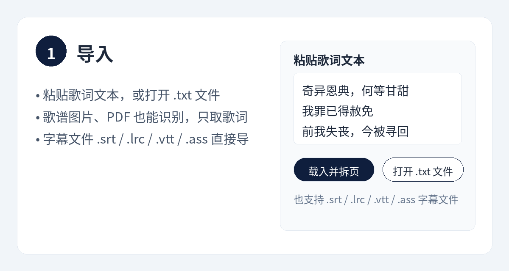
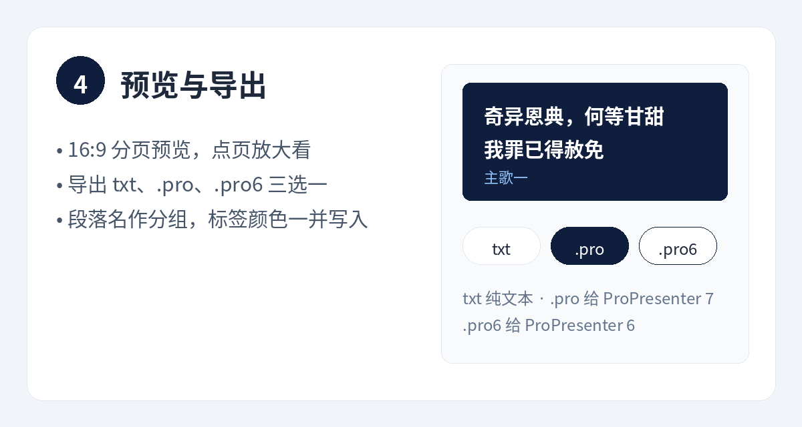
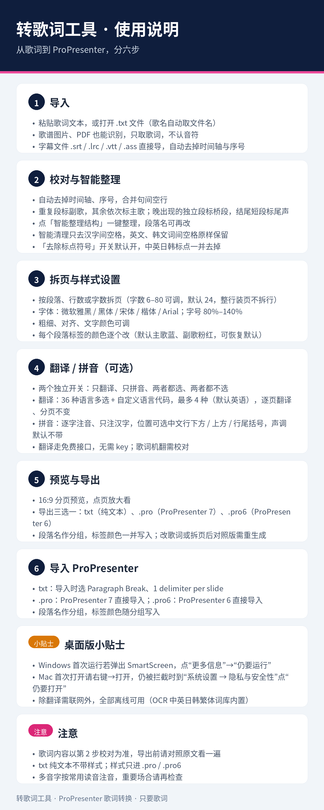
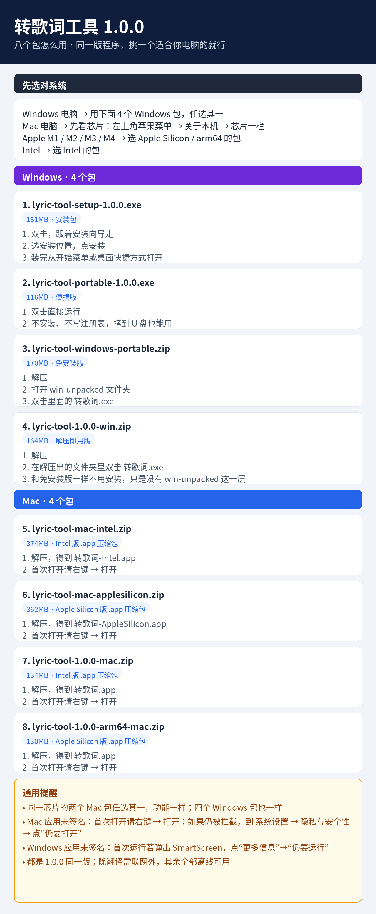

# 转歌词工具

把歌词文本、歌谱图片、字幕文件，整理成 ProPresenter 可直接导入的分页歌词。只要歌词，不要音符。

## 用法

顶部五胶囊切换模块：导入歌词／校对歌词／拆页与样式／翻译·拼音／分页预览，粘贴载入、字幕导入、识别完自动切到校对，生成对照版后自动切到分页预览。

### 1. 导入

- 粘贴歌词文本，或打开 `.txt` 文件（歌名自动取文件名）
- 歌谱图片、PDF 也能识别，只取歌词，不认音符
- 字幕文件 `.srt` / `.lrc` / `.vtt` / `.ass` 直接导

### 2. 校对与智能整理

- 自动去掉时间轴、序号与句间空行
- 重复段标副歌，其余依次标主歌；晚出现的独立段标桥段，结尾短段标尾声
- 一键「智能整理结构」，段落名可再改
- 智能清理：只去汉字间空格，英文、韩文词间空格原样保留
- 歌谱整理：一键去掉和弦行、简谱数字行与谱头信息，按主歌/副歌/桥段等段落分组；谱面上下两行歌词的，开「双行歌词」再整理，会按两遍拆成主歌一、主歌二
- 谱头清除：第一句真歌词前整段去掉，专辑/原曲/年份/拉丁乱码行在正文任何位置也删
- 副歌合并：两遍词不同的副歌按演唱顺序排进同一副歌段
- 红清单：含汉字又删过拉丁乱码的行，整理后下方红色清单列出原行、删掉的乱码、删完的样子
- 断句规则：先按标点断句再去标点，碎行合并看标点
- 纯粘贴分段标注与可疑行标记：粘贴的歌词也能分段标注，可疑行单独标记
- 段落标记多语言识别：日韩＋世界常规语言段落词都能认，段落名按标记语言输出（`[Chorus]`→Chorus、`[サビ]`→サビ、`[후렴]`→후렴，无标记推断用歌中已出现标记的语言，全首无标记按歌词主导语言）
- 歌谱识别语言 33 项（默认多语言混合），识别前预处理（放大、灰度、对比增强、整块文本模式保行序）
- 识别引擎双选：快速识别（默认）即开即用；增强识别 · PaddleOCR 本机识别、图片不上传，首次联网下载模型约 15MB 带进度、缓存，失败自动回退快速识别
- 全网搜索匹配 · 对照纠错：自动挑最干净词句作搜索词，先查 LRCLIB 再经 DuckDuckGo 代理兜底，候选逐行对照（相同 / 差异逐字高亮 / 谱面独有 / 网上多出），逐行采用网上、按候选分段重组，谱面为准、全程不自动覆盖

### 3. 拆页与样式设置

- 按段落、行数或字数拆页（字数 6–80 可调，默认 24，整行装页不拆行）
- 字体（微软雅黑 / 黑体 / 宋体 / 楷体 / Arial）、字号 80%–140%、粗细、对齐、文字颜色
- 每个段落标签的颜色逐个改（默认主歌蓝、副歌粉红）
- 改动同步进预览与 `.pro` / `.pro6`

### 4. 翻译 / 拼音（可选）

- 两个独立开关：只翻译、只拼音、两者都选、两者都不选
- 翻译：36 种语言多选 + 自定义语言代码，最多 4 种（默认英语），逐页逐语言翻译，分页不变
- 翻译跳过同语言行：某行本身就是目标语言时跳过该行该目标语言的翻译，避免同页出现两句相同歌词
- 拼音：逐字注音、只注汉字，位置可选中文行下方 / 上方 / 行尾括号，声调默认不带
- 翻译走免费接口，无需 key；歌词机翻需校对

### 5. 预览与导出

- 16:9 分页预览，点页放大看
- 导出三选一：`txt`（纯文本，不带样式）、`.pro`（ProPresenter 7）、`.pro6`（ProPresenter 6）
- 段落名作分组，标签颜色一并写入

### 完整使用说明

## 下载（当前版本 1.2.0）

| 包 | 适用 | 用法 |
| --- | --- | --- |
| [lyric-tool-setup-1.2.0.exe](https://github.com/kaylechou/propresenter-lyric-tool/releases/download/v1.2.0/lyric-tool-setup-1.2.0.exe) | Windows | 安装包，双击按向导安装 |
| [lyric-tool-portable-1.2.0.exe](https://github.com/kaylechou/propresenter-lyric-tool/releases/download/v1.2.0/lyric-tool-portable-1.2.0.exe) | Windows | 便携版，双击直接运行 |
| [lyric-tool-windows-portable.zip](https://github.com/kaylechou/propresenter-lyric-tool/releases/download/v1.2.0/lyric-tool-windows-portable.zip) | Windows | 免安装版，解压后运行 `win-unpacked/转歌词.exe` |
| [lyric-tool-1.2.0-win.zip](https://github.com/kaylechou/propresenter-lyric-tool/releases/download/v1.2.0/lyric-tool-1.2.0-win.zip) | Windows | 解压即用版，解压后直接运行 `转歌词.exe` |
| [lyric-tool-mac-intel.zip](https://github.com/kaylechou/propresenter-lyric-tool/releases/download/v1.2.0/lyric-tool-mac-intel.zip) | Mac（Intel 芯片） | 解压得 `转歌词-Intel.app`，首次右键 → 打开 |
| [lyric-tool-mac-applesilicon.zip](https://github.com/kaylechou/propresenter-lyric-tool/releases/download/v1.2.0/lyric-tool-mac-applesilicon.zip) | Mac（Apple Silicon，M1 / M2 / M3 / M4） | 解压得 `转歌词-AppleSilicon.app`，首次右键 → 打开 |
| [lyric-tool-1.2.0-mac.zip](https://github.com/kaylechou/propresenter-lyric-tool/releases/download/v1.2.0/lyric-tool-1.2.0-mac.zip) | Mac（Intel 芯片） | 解压得 `转歌词.app`，首次右键 → 打开 |
| [lyric-tool-1.2.0-arm64-mac.zip](https://github.com/kaylechou/propresenter-lyric-tool/releases/download/v1.2.0/lyric-tool-1.2.0-arm64-mac.zip) | Mac（Apple Silicon） | 解压得 `转歌词.app`，首次右键 → 打开 |

八个包怎么用，详见下图：

## 桌面版说明

- Windows、Mac 桌面版除翻译、PaddleOCR 增强识别首次下载模型需联网外，全部离线可用
- 安装包未签名：Windows 首次运行若弹出 SmartScreen，点“更多信息”→“仍要运行”；Mac 首次打开请右键 → 打开，仍被拦截时到“系统设置 → 隐私与安全性”点“仍要打开”
- Mac 芯片查看方法：左上角苹果菜单 → 关于本机 → 芯片一栏
- 启动自动检测更新：打开软件后自动检查新版本，有新版会弹窗提示，可一键下载更新（Windows 下载后自动打开安装程序，Mac 下载后请解压替换旧版）

## 导入 ProPresenter

- `txt`：导入时选 Paragraph Break、1 delimiter per slide
- `.pro`：ProPresenter 7 直接导入；`.pro6`：ProPresenter 6 直接导入
- 段落名作分组，标签颜色随分组写入

## 注意

- 歌词内容以第 2 步校对为准，导出前请对照原文看一遍
- 翻译是机翻，重要场合请校对；多音字按常用读音注音，重要场合请再检查
