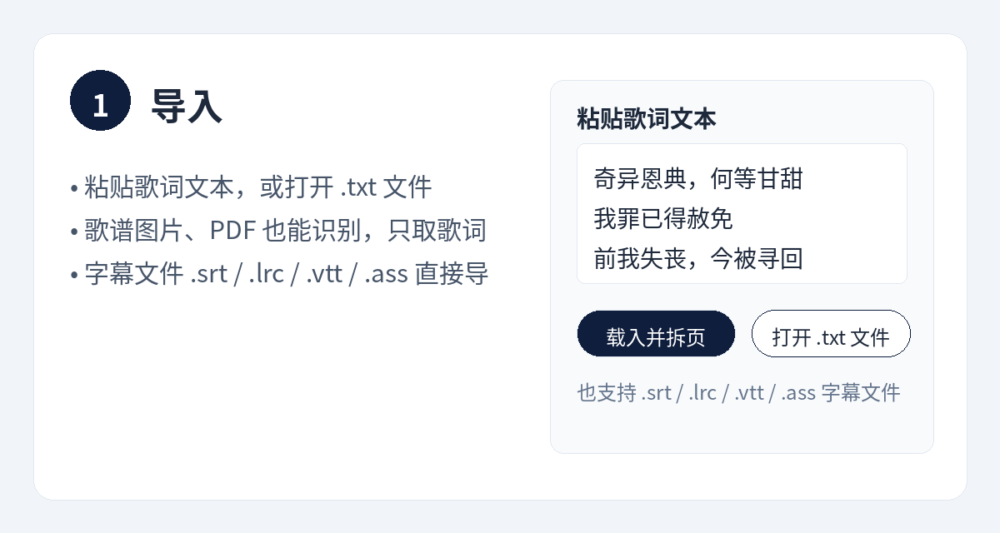
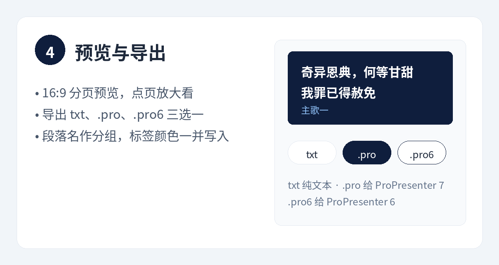
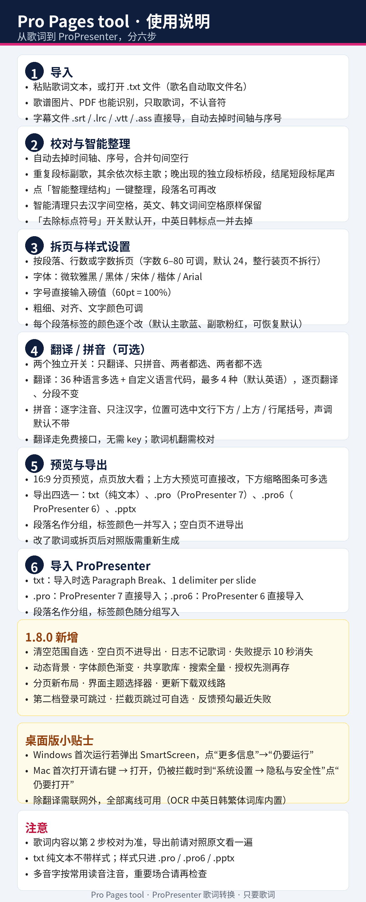
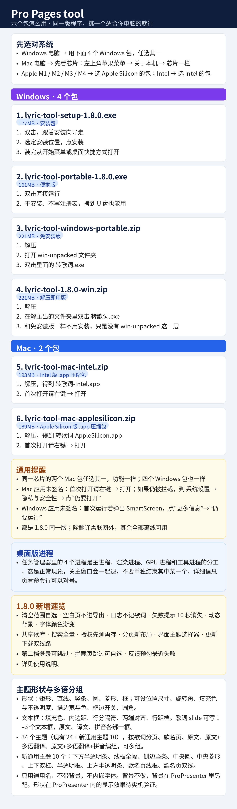

# Pro Pages tool

把歌词文本、歌谱图片、字幕文件，整理成 ProPresenter 可直接导入的分页歌词。只要歌词，不要音符。

## 1.8.1 新增

- 搜索直连优化：直连抓搜索页补了浏览器信息，百度不开网络工具也能搜到
- 分页预览三处修：主预览区铺满整宽（每边留 2px）、选中页弹层放大、流程步骤颜色跟随 5 个界面主题
- 搜索可手动停止、暂停、继续：搜索进行中状态区下方出停止、暂停按钮；停止彻底终止，暂停后点继续从断点恢复、不重搜
- 搜索受限提示：候选很少且确实有引擎受限时才提示，可开网络工具重试或改用百度；正常有结果时不提示

## 用法

顶部九胶囊切换模块：导入歌词／校对歌词／拆页／字体／段落／样式／翻译·拼音／分页预览／歌库，粘贴载入、字幕导入、识别完自动切到校对，生成对照版后自动切到分页预览。页首标题栏右侧有「使用说明」按钮，点开是十三节短句版使用说明。

### 1. 导入



- 粘贴歌词文本，或打开 `.txt` 文件（歌名自动取文件名）
- 歌谱图片、PDF 也能识别，只取歌词，不认音符
- 字幕文件 `.srt` / `.lrc` / `.vtt` / `.ass` 直接导

### 2. 校对与智能整理


- 自动去掉时间轴、序号与句间空行
- 重复段标副歌，其余依次标主歌；晚出现的独立段标桥段，结尾短段标尾声
- 一键「智能整理结构」，段落名可再改
- 智能清理：只去汉字间空格，英文、韩文词间空格原样保留
- 去括号拼音：第 2 步默认开启的开关，只有括号内全部为合法拼音音节才连括号去掉，英文与说明括号保留
- 繁简互转：校对区转简体、转繁体一键全文原地互转，只转歌词正文，歌名／歌手框不动，空行分段与段落名行位置不变；歌词菜单同步有转简体、转繁体两项
- 歌谱整理：一键去掉和弦行、简谱数字行与谱头信息，按主歌/副歌/桥段等段落分组；谱面上下两行歌词的，开「双行歌词」再整理，会按两遍拆成主歌一、主歌二
- 谱头清除：第一句真歌词前整段去掉，专辑/原曲/年份/拉丁乱码行在正文任何位置也删
- 副歌合并：两遍词不同的副歌按演唱顺序排进同一副歌段
- 红清单：含汉字又删过拉丁乱码的行，整理后下方红色清单列出原行、删掉的乱码、删完的样子
- 断句规则：先按标点断句再去标点，碎行合并看标点
- 纯粘贴分段标注与可疑行标记：粘贴的歌词也能分段标注，可疑行单独标记
- 段落标记多语言识别：日韩＋世界常规语言段落词都能认，段落名按标记语言输出（`[Chorus]`→Chorus、`[サビ]`→サビ、`[후렴]`→후렴，无标记推断用歌中已出现标记的语言，全首无标记按歌词主导语言）
- 歌谱识别语言 33 项（默认多语言混合），识别前预处理（放大、灰度、对比增强、整块文本模式保行序）
- 识别引擎双选：快速识别（默认）即开即用；增强识别 · PaddleOCR 本机识别、图片不上传；33 门识别数据与 PaddleOCR 模型已全部内置本机，离线可用，失败自动回退快速识别
- 云端识别：大模型识谱，谱面复杂、快速／增强认不准时用；模型按提供方分组（Gemini、智谱、通义、硅基流动），密钥按提供方分别保存、只存本机，失败自动回退本地识别；云端识别出的歌名、歌手自动填入歌名／歌手框（已有内容不覆盖）；识别走两路，优先直连各家接口（桌面走主进程，网页直接调接口），只有发不出去才自动切换，提供方拒答即最终结论不切换；密钥先测再存：点保存先测密钥，可用才存，不可用不存并显示失败原因
- 全网搜索（第 1 步第三页签）：填歌名（可再填歌手、专辑）搜索；三路全跑完再合并，不再找到就停；直连加百度、Bing，四路并行；候选点「查看并编辑」先看全文，结果框可直接改文字，点「生成分页预览」即用改后歌词拆页；换一换、重新搜索、相关性门槛（无关结果滤掉）、各路结果明细、简繁双搜繁转简、歌名英日韩轮询；搜不到不编造；搜索多路并行、候选并行预拉，总体更快
- 搜索三级路由：直连→备用线路补位→免费代理兜底；抓取按响应头与 meta 判定编码解 GBK/Big5，实体单遍全量解码，损坏内容自动降级重抓；桌面版直连走主进程本机网络（不受浏览器跨域限制），本机能直达的站不再绕备用线路
- Musixmatch：只走公开页抓取，无密钥、无登录；公开页抓不到，点状态区下方的“跳过这一步”，不等它、直接进网页搜索，迟到的结果不再追加
- 授权先测再存：其它网站要登录或填密钥时，按该站实际反馈决定授权方式，不填就点跳过进下一步；授权完先测可用、可用才保存在工具里；登录过的站记在本机，下次不再重复问
- 第二档登录可跳过（只桌面版）：6 站登录弹窗加“跳过这一步”，点后关弹窗、该候选标记已跳过、登录按钮隐藏、状态显示“已跳过{站名}，继续看下一个来源…”
- 拦截页跳过可自选：抓取弹拦截页提示时，取消改为跳过本候选；跳过后回候选列表或自动取下一个，设置里自选，默认回候选列表
- 共享歌库：全网搜索亦搜共享歌库，共享结果优先排；首次共享先弹同意说明，同意后才共享，同意可随时撤回
- 谱头粘连行过滤：速度数字与标题粘连成一行的谱头行不再漏进歌词

### 3. 拆页与样式设置


- 按段落、行数或字数拆页（字数 6–80 可调，默认 24，整行装页不拆行）
- 字体（微软雅黑 / 黑体 / 宋体 / 楷体 / Arial）、字号直接输入具体磅值（全页统一，与百分比滑杆同步，60pt=100%）、粗细、对齐、文字颜色；段落预设：行高倍数、行距百分比、段落间距、字符间距、边距（左/上/右/下）、描边（开关/宽度/颜色）、阴影（开关/角度/偏移/模糊/透明度/颜色）
- 每个段落标签的颜色逐个改（默认主歌蓝、副歌粉红）
- 改动同步进预览与 `.pro` / `.pro6`
- 导出文本框铺满 1920×1080（边距为 0 时），导出无页末空行
- 字体颜色渐变：只支持两色，做 .pro / .proTheme / .pptx ＋预览；.pro6 不做；角度＋色标列表，元素级＋逐段级两处；.proTheme 样例 298.0°；教会电脑实机验
- 动态背景：视频可导入，在预览里循环播放；导出与自适应放下一步
- 清空范围：清空时自己选范围，保留“全部恢复默认”；换新歌词、换新歌名时自动清掉之前设置；“沿用上一首设置”默认关；自己改的设置可存为自定义预设，名字可编辑

### 4. 翻译 / 拼音（可选）

- 两个独立开关：只翻译、只拼音、两者都选、两者都不选
- 翻译：36 种语言多选 + 自定义语言代码，最多 4 种（默认英语），逐页逐语言翻译，分页不变
- 翻译跳过同语言行：某行本身就是目标语言时跳过该行该目标语言的翻译，避免同页出现两句相同歌词
- 翻译首字母大写（中日韩、阿拉伯、希伯来、印地、泰语除外），预览与 txt/.pro/.pro6 一致
- 译文/拼音点改（1.5.0 修复）：预览卡片与放大查看内译文行、拼音行点一下变输入框，回车或失焦确认、Esc 取消，改动同步导出，重新生成对照版会覆盖手动修改
- 拼音：逐字注音、只注汉字，位置可选中文行下方 / 上方 / 行尾括号，声调默认不带
- 翻译走免费接口，无需 key；歌词机翻需校对

### 5. 预览与导出



- 分页预览新布局：上方大预览铺满、可直接改；下方缩略图条，带页码、上一页 / 下一页，单选多选，多选批量指定主题样式
- 16:9 分页预览，点页放大看
- 导出四选一：`txt`（纯文本，不带样式）、`.pro`（ProPresenter 7）、`.pro6`（ProPresenter 6）、`.pptx`
- 空白页不进导出：空白页只在预览里可见
- 段落名作分组，标签颜色一并写入；.pro6 形状按非官方逆向资料实现，未经 ProPresenter 6 真机验证

### 完整使用说明



页首标题栏右侧「使用说明」按钮可打开十三节短句版使用说明（导入、识别引擎、校对、拆页样式、翻译拼音、预览导出、歌库、桌面版不同之处、菜单一览、通用规则）；说明顶部固定置顶仓库地址条。

## 下载（当前版本 1.8.0）

| 包 | 适用 | 用法 |
| --- | --- | --- |
| [lyric-tool-setup-1.8.0.exe](https://github.com/kaylechou/propresenter-lyric-tool/releases/download/v1.8.0/lyric-tool-setup-1.8.0.exe) | Windows | 安装包（177MB），双击按向导安装 |
| [lyric-tool-portable-1.8.0.exe](https://github.com/kaylechou/propresenter-lyric-tool/releases/download/v1.8.0/lyric-tool-portable-1.8.0.exe) | Windows | 便携版（161MB），双击直接运行 |
| [lyric-tool-windows-portable.zip](https://github.com/kaylechou/propresenter-lyric-tool/releases/download/v1.8.0/lyric-tool-windows-portable.zip) | Windows | 免安装版（221MB），解压后运行 `win-unpacked/转歌词.exe` |
| [lyric-tool-1.8.0-win.zip](https://github.com/kaylechou/propresenter-lyric-tool/releases/download/v1.8.0/lyric-tool-1.8.0-win.zip) | Windows | 解压即用版（221MB），解压后直接运行 `转歌词.exe` |
| [lyric-tool-mac-intel.zip](https://github.com/kaylechou/propresenter-lyric-tool/releases/download/v1.8.0/lyric-tool-mac-intel.zip) | Mac（Intel 芯片） | （193MB）解压得 `转歌词-Intel.app`，首次右键 → 打开 |
| [lyric-tool-mac-applesilicon.zip](https://github.com/kaylechou/propresenter-lyric-tool/releases/download/v1.8.0/lyric-tool-mac-applesilicon.zip) | Mac（Apple Silicon，M1 / M2 / M3 / M4） | （189MB）解压得 `转歌词-AppleSilicon.app`，首次右键 → 打开 |
| [SHA256SUMS.txt](https://github.com/kaylechou/propresenter-lyric-tool/releases/download/v1.8.0/SHA256SUMS.txt) | 全部 | 下载完整性校验对照表（工具自动更新时自动取用） |
| [lyric-tool-1.8.0-install-details.txt](https://github.com/kaylechou/propresenter-lyric-tool/releases/download/v1.8.0/lyric-tool-1.8.0-install-details.txt) | 全部 | 安装细节：下载哪个包、Windows/Mac 安装步骤、常见问题 |
| [lyric-tool-1.8.0-usage-guide.txt](https://github.com/kaylechou/propresenter-lyric-tool/releases/download/v1.8.0/lyric-tool-1.8.0-usage-guide.txt) | 全部 | 完整使用说明（纯文本版，不用安装也能看） |

六个包怎么选：Windows 4 个任选其一，Mac 按芯片选一个；六包合计约 1.22 GB。安装细节与完整使用说明另有纯文本版（上表最后两行），随 release 附件一起下载。六个包怎么用，详见下图：



Mac 打不开（提示“已损坏”）怎么办：安装包未签名，属正常现象，包本身没坏。先解压，对解压出的 `.app` 清掉浏览器下载隔离标记再打开，命令里的文件名必须与实际一致（重复下载的文件名会带 `-2` 后缀）：

```
xattr -cr ~/Downloads/转歌词-AppleSilicon.app
```

Intel 芯片把名字换成 `转歌词-Intel.app`。也可以把 `.app` 拖进终端窗口再跑 `xattr -cr`。如果已经点过损坏提示，先删掉重解压，解压完先清标记再打开；首次打开请右键 → 打开。


## 桌面版说明

- Windows、Mac 桌面版除翻译、云端识别、搜索需联网外，全部离线可用（33 门识别数据与 PaddleOCR 模型已内置本机）
- 安装包未签名：Windows 首次运行若弹出 SmartScreen，点“更多信息”→“仍要运行”；Mac 首次打开请右键 → 打开，仍被拦截时到“系统设置 → 隐私与安全性”点“仍要打开”
- Mac 芯片查看方法：左上角苹果菜单 → 关于本机 → 芯片一栏
- 启动自动检测更新：打开软件后自动检查新版本，有新版会弹窗提示，可一键下载更新（Windows 下载并校验通过后会先问是否继续安装，确认后打开安装程序并在向导里选安装路径，同时打开下载文件夹，装完后可自行决定是否删除安装包，Mac 下载后请解压替换旧版）；手动点菜单「检查更新」时，已是最新版、未取到版本、检查失败都会弹提示，自动检查仍静默；更新检查与下载先走直连、直连不通回备用线路，8 连接分段下载、断点续传，更新弹窗显示对应版本的发版正文；两路失败弹窗显示真实原因并可点“直接下载最新版”用浏览器直接下载对应安装包
- 更新下载双线路：点“立即下载”后按网络情况自动选线路，不用每次问；顺序为 GitHub → 普鲁文第 9 分享 → 备用线路；更新检查仍走直连 GitHub API，备用线路兜底
- 字体启动缓存：启动先显示缓存字体，再后台强制刷新；新装字体能进来
- 运行日志：帮助菜单里点“运行日志”查看；只记操作、环节、错误码、耗时，不记歌词正文与搜索词；留 1000 条；每条带日期
- 失败提示：任何操作出问题，右下角浮出小窗，带真实问题与原因；10 秒自动消失
- 提示纯色深底：全部主题的通知与失败提示都用纯色深底；静态说明提示保持偏淡，不改
- 界面主题 5 个：活力粉青、科技冰蓝、经典暖纸、时尚紫罗兰、液态玻璃；桌面版在视图 → 主题里切，网页版在顶栏“界面主题”下拉框里切，默认经典暖纸，选择会记住；网页版左下角悬浮按钮切手机版 / 电脑版
- 关于置顶：桌面版「关于」顶部固定显示 GitHub 仓库地址
- 下载完整性校验：更新下载完成后自动验尺寸＋SHA256（对照表 SHA256SUMS.txt），不一致重下最多 3 次，仍不一致不打开并报错
- 语义纠错建议：本地词典＋搭配检查，只标建议、不自动改，接受才改行并同步导出
- 云端识别：Gemini（免费档）或智谱／通义／硅基流动，各平台建密钥、只贴工具对应提供方令牌框、只存本机；识别优先直连各家接口（桌面走主进程），直连不通自动切换，提供方拒答不切换；失败回退本地识别
- 流量全加密：所有对外请求一律 HTTPS；域名加密 ECH，不改系统 DNS、不覆盖代理设置

## 导入 ProPresenter

- `txt`：导入时选 Paragraph Break、1 delimiter per slide
- `.pro`：ProPresenter 7 直接导入；`.pro6`：ProPresenter 6 直接导入
- 段落名作分组，标签颜色随分组写入

## 注意

- 歌词内容以第 2 步校对为准，导出前请对照原文看一遍
- 翻译是机翻，重要场合请校对；多音字按常用读音注音，重要场合请再检查
- 渐变与主题形状在 ProPresenter 里的显示效果，教会电脑实机验
